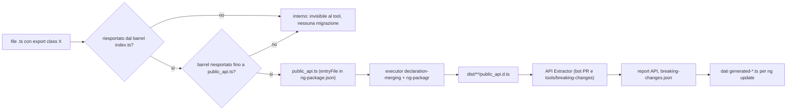
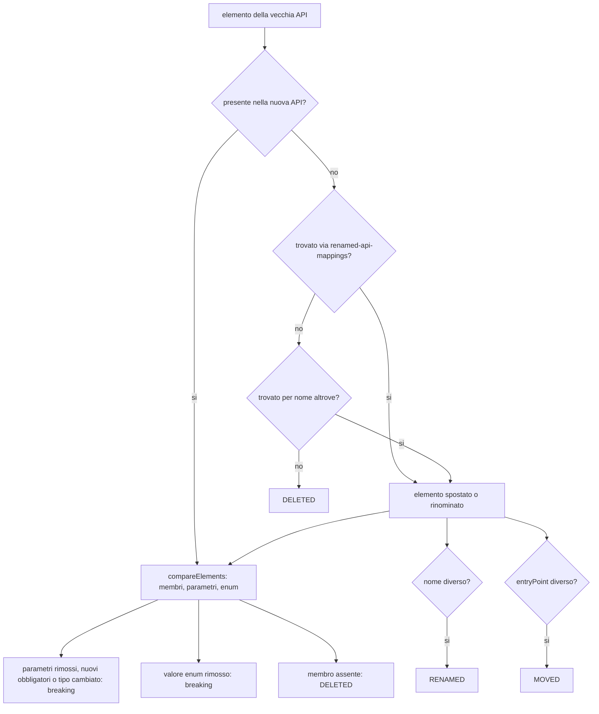
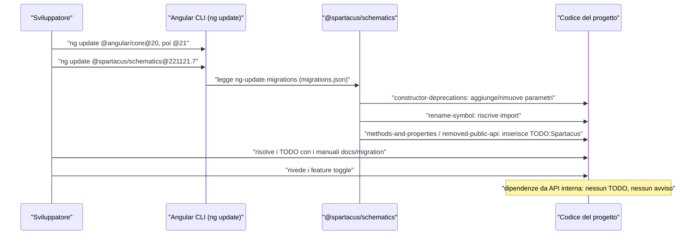

# 54 — API pubblica vs interna, upgrade, anti-pattern, checklist upgrade-safe

> Riferimenti allo SHA `5b7a1c2bf2808d7380bc20596d10f4fa710c3da1` (vedi [00-meta](../00-meta.md)).

## 1. A cosa serve e perché esiste

Le ricette dei capitoli 50–53 insegnano a *estendere* Spartacus: config, DI, componenti CMS, adapter OCC, feature lazy. Questo capitolo chiude la Parte III e risponde alla domanda che viene dopo: **la mia estensione sopravvivrà al prossimo `ng update`?**

Il progetto si presenta come un insieme di librerie che "follows semantic versioning conventions … upgradable for minor and patch releases" (`README.md:L31-L32`), con una "roll-forward update policy" (`docs/README.md:L5-L5`). La promessa vale però solo per una cosa precisa: la **superficie pubblica** dei pacchetti, cioè ciò che è raggiungibile dai file `public_api.ts` dichiarati come `entryFile` in ogni `ng-package.json` (`core-libs/core/ng-package.json:L1-L7`, `core-libs/core/public_api.ts:L7-L36`). Il resto, anche se sta in una classe `export`ata in un file sorgente, è implementazione e può cambiare senza preavviso.

Il repository rende questo confine verificabile con diversi strumenti:

- i barrel `index.ts`, che decidono cosa arriva al `public_api.ts` (F2, F28–F49 del dossier);
- un bot CI che fa il diff dei report di API Extractor a ogni PR (`.github/workflows/breaking-changes-detection-bot.yml:L1-L35`);
- un tool offline che confronta due versioni e genera i dati delle migrazioni `ng update` (`tools/breaking-changes/package.json:L1-L27`, `tools/breaking-changes/common.ts:L12-L19`);
- regole ESLint che proteggono l'estendibilità per sottoclasse (`eslint.config.mjs:L179-L192`, `tools/eslint-rules/index.ts:L86-L100`);
- feature toggle strict per introdurre gradualmente i breaking change (`core-libs/core/src/features-config/feature-toggles/config/feature-toggles.ts:L7-L11`).

Il capitolo ha quattro parti operative: come riconoscere l'API pubblica, cosa si rompe davvero negli upgrade e perché, una serie di anti-pattern con la loro alternativa basata solo su API pubblica, e una checklist verificabile.

Capitoli collegati: il meccanismo dei toggle e delle deprecazioni è in [42 — Feature toggle e deprecazioni](../parte-2/42-feature-toggle-deprecazioni.md); il motore `ng update` e i mechanism di migrazione in [43 — Schematics e migrazioni](../parte-2/43-schematics-migrazioni.md). Le ricette che questo capitolo "mette in sicurezza" sono [50 — config, DI, interceptor, eventi](../parte-3/50-ricette-config-di.md), [51 — CMS, outlet, layout](../parte-3/51-ricette-cms-outlet-layout.md), [52 — OCC e dati](../parte-3/52-ricette-occ-dati.md) e [53 — feature lazy, carrello/checkout, stili, i18n](../parte-3/53-ricette-feature-cart-checkout-stili-i18n.md).

> Nota sulle versioni: i pacchetti libreria allo SHA sono `221121.22.0` (`core-libs/core/package.json:L3-L3`), la root del monorepo `2612.0.0` (`package.json:L3-L3`). Le migrazioni `ng update` usano la numerazione dei pacchetti (`core-libs/schematics/src/migrations/migrations.json:L103-L122`).

## 2. Mappa dei file

| Path | Ruolo |
|---|---|
| `core-libs/core/ng-package.json` | dichiara `entryFile: ./public_api.ts` e `dest` del pacchetto `@spartacus/core` |
| `core-libs/core/public_api.ts` | superficie pubblica di core: 27 barrel + blocco `AUGMENTABLE_TYPES_START`…`_END` |
| `core-libs/storefront/public_api.ts` | superficie pubblica di storefront: 11 barrel + `ICON_TYPE`, `BREAKPOINT`, `LAUNCH_CALLER` augmentabili |
| `core-libs/setup/public_api.ts`, `core-libs/setup/ssr/public_api.ts` | `@spartacus/setup` e l'entry point secondario SSR |
| `feature-libs/**/ng-package.json`, `feature-libs/**/public_api.ts` | entry point secondari (`@spartacus/<lib>/<entry>`), 314 in tutto |
| `docs/libs/library-structure.md` | convenzione `root/` (eager) vs `core/`, `components/`, `occ/` (lazy) |
| `tools/build-lib/declaration-merging/index.ts` | builder usato dalle librerie: riscrive i `declare module` relativi nel `.d.ts` appiattito |
| `tools/build-lib/augmented-types/index.ts` | builder storico (registrato, non usato) per spostare il blocco augmentabile |
| `tools/breaking-changes/*.ts`, `readme.md`, `api-extractor.json` | pipeline offline: extract → parse → compare → gen dei dati di migrazione |
| `tsconfig.api-extractor.json` | tsconfig non-strict per API Extractor |
| `.github/workflows/breaking-changes-detection-bot.yml`, `.github/api-extractor-action/**` | bot PR che commenta i diff dell'API |
| `core-libs/schematics/package.json` | aggancio `ng-update.migrations` + `packageGroup` |
| `core-libs/schematics/src/migrations/migrations.json` | 25 migrazioni registrate per versione |
| `core-libs/schematics/src/migrations/221121_7/*/data/generated-*.ts` | dati generati di deprecazione (costruttori, membri, API rimosse, rename) |
| `core-libs/schematics/src/migrations/mechanism/**` | motori generici delle migrazioni |
| `core-libs/schematics/src/shared/utils/file-utils.ts` | interfacce dei dati di deprecazione |
| `core-libs/schematics/README.md` | processo per aggiungere una migrazione |
| `core-libs/core/src/features-config/**` | feature toggle (dettaglio in cap. 42) |
| `tools/eslint-rules/index.ts`, `tools/eslint-rules/rules/*.ts` | regole custom legate all'estendibilità |
| `eslint.config.mjs`, `projects/storefrontapp/eslint.config.mjs` | wiring delle regole |
| `core-libs/core/src/config/config-tokens.ts`, `core-libs/core/src/config/services/configuration.service.ts` | costruzione e mutazione in-place del `Config` globale |
| `docs/migration/221121_7/*.md` | guide di migrazione manuali e generate |
| `docs/libs/major-release-checklist.md` | rimozione delle migrazioni della major precedente |

## 3. Come funziona passo per passo

### 3.1 API pubblica vs interna

#### 3.1.1 L'entry point è il contratto

Ogni pacchetto (o entry point secondario) ha un `ng-package.json` che punta a un `public_api.ts`:

- `@spartacus/core`: `entryFile: ./public_api.ts`, output `../../dist/core` (`core-libs/core/ng-package.json:L1-L7`).
- `@spartacus/assets` fa eccezione: `./src/public_api.ts` (`core-libs/assets/ng-package.json:L1-L7`).
- `@spartacus/setup` esporta solo `./recipes/index`; l'SSR è un entry point secondario separato con il proprio `public_api.ts` (`core-libs/setup/public_api.ts:L7-L7`, `core-libs/setup/ssr/ng-package.json:L1-L6`, `core-libs/setup/ssr/public_api.ts:L7-L16`).
- Le feature lib multi-entry hanno un `ng-package.json` per sotto-cartella, es. `@spartacus/cart/base/root` (`feature-libs/cart/base/root/ng-package.json:L1-L6`, `feature-libs/cart/base/root/public_api.ts:L7-L16`). Lo stesso vale per i singoli componenti: `@spartacus/cart/base/components/add-to-cart` ha `ng-package.json` e `public_api.ts` propri (`feature-libs/cart/base/components/add-to-cart/ng-package.json:L1-L6`, `feature-libs/cart/base/components/add-to-cart/public_api.ts:L7-L8`).

La convenzione di libreria è documentata: `root/` è EAGER (facade astratte, modelli, eventi, token, config), mentre `core/`, `components/`, `occ/` sono LAZY; "each entry point has own `public_api.ts`. Import as `@spartacus/<lib>/<entry-point>`" (`docs/libs/library-structure.md:L4-L16`). In sviluppo gli alias `@spartacus/*` del `tsconfig.json` puntano ai `public_api` sorgente, nella build di produzione dell'app a `dist/*` (`tsconfig.json:L795-L796`, `projects/storefrontapp/tsconfig.app.prod.json:L508-L509`).

Il `public_api.ts` di core è una lista di `export * from './src/<area>/index'` (`core-libs/core/public_api.ts:L7-L36`). Ne segue la regola pratica: **un simbolo è pubblico se e solo se la catena `public_api.ts` → `index.ts` → ... → file lo riesporta**. Un `export class` in un file non basta.

#### 3.1.2 Come si riconosce l'interno

Spartacus *non* usa le convenzioni di Angular per marcare il privato:

- **Prefisso `ɵ`**: Angular riesporta simboli privati con alias `ɵ…` (`angular:packages/core/src/core_private_export.ts:L8-L20`). In Spartacus nessun simbolo lo usa; l'unica occorrenza non-spec è un separatore di stringa (`core-libs/core/src/product/services/product-loading.service.ts:L88-L90`).
- **`@internal`**: compare una sola volta, su `ConfigInitializerService.initialize()` "Not a part of a public API, used by APP_INITIALIZER", ma il metodo resta `public` nella classe esportata (`core-libs/core/src/config/config-initializer/config-initializer.service.ts:L124-L130`). È solo documentale.

I segnali reali sono tre.

**(a) Assenza dal barrel.** È il caso normale. Campione riverificato nel dossier (F36–F49):

| Simbolo non pubblico | Definito in | Barrel che lo esclude | Alternativa pubblica |
|---|---|---|---|
| `LazyLoadingModule` | `core-libs/core/src/lazy-loading/lazy-loading.module.ts` | `core-libs/core/src/lazy-loading/index.ts:L7-L12` | importato da `BaseCoreModule` (`core-libs/core/src/base-core.module.ts:L41-L41`) |
| `CombinedInjector` | `core-libs/core/src/util/combined-injector.ts:L27-L27` | `core-libs/core/src/util/index.ts:L7-L29` | — |
| `TRANSFER_STATE_META_REDUCER`, `CX_KEY` | `core-libs/core/src/state/reducers/transfer-state.reducer.ts:L16-L16` | `core-libs/core/src/state/index.ts:L7-L11` (non riesporta `reducers`) | — |
| `HttpErrorInterceptor` | `core-libs/core/src/global-message/http-interceptors/http-error.interceptor.ts` | `core-libs/core/src/global-message/http-interceptors/index.ts:L20-L22` (solo importato) | `HttpErrorHandler` + `errorHandlers` |
| `provideMultiErrorHandler()` | `core-libs/core/src/error-handling/multi-error-handler/provide-multi-error-handler.ts:L11-L19` | `core-libs/core/src/error-handling/multi-error-handler/index.ts:L7-L8` | `MULTI_ERROR_HANDLER` (`core-libs/core/src/error-handling/multi-error-handler/multi-error-handler.ts:L25-L25`) |
| `CouponSearchPageResolver` | `core-libs/core/src/product/services/coupon-search-page-meta.resolver.ts:L33-L33` | `core-libs/core/src/product/services/index.ts:L7-L11` | — |
| `I18NEXT_LOGGER_PLUGIN` | `core-libs/core/src/i18n/i18next/i18next-plugins/i18next-logger-plugin.ts:L17-L17` | `core-libs/core/src/i18n/i18next/index.ts:L7-L10` | — |
| `WebComponentHandler` | `core-libs/storefront/cms-structure/page/component/handlers/web-component.handler.ts:L30-L30` | `core-libs/storefront/cms-structure/page/component/handlers/index.ts:L7-L9` | — |
| `ContextToken` | `core-libs/storefront/context/context.model.ts:L7-L7` | `core-libs/storefront/context/index.ts:L7-L8` | — |
| `AsmBindCartService` | `feature-libs/asm/core/facade/asm-bind-cart.service.ts:L16-L16` | `feature-libs/asm/core/facade/index.ts:L7-L9` | `AsmBindCartFacade` (`feature-libs/asm/root/facade/index.ts:L7-L7`) |
| `UserIdHttpHeaderInterceptor` | `feature-libs/asm/root/interceptors/user-id-http-header.interceptor.ts:L30-L30` | `feature-libs/asm/root/public_api.ts:L7-L14` | — |
| `CheckoutCartInterceptor` | `feature-libs/checkout/base/root/http-interceptors/checkout-cart.interceptor.ts:L27-L27` | `feature-libs/checkout/base/root/public_api.ts:L7-L16` | — |
| `SegmentRefsConfig` | `integration-libs/segment-refs/root/config/segment-refs-config.ts:L14-L14` | `integration-libs/segment-refs/root/public_api.ts:L7-L7` | — |

**(b) Commenti espliciti nel sorgente.** Il repo li usa in modo non uniforme ma riconoscibile:

- `// PRIVATE API` su `MergingSubject` (`core-libs/core/src/event/utils/merging-subject.ts:L10-L10`) e su `SiteContextRoutesHandler` (`core-libs/core/src/site-context/services/site-context-routes-handler.ts:L21-L25`);
- "functions below should not be exposed in public API" su `siteContextParamsProviders`, che sostituisce `UrlSerializer` (`core-libs/core/src/site-context/providers/site-context-params-providers.ts:L12-L18`);
- `CmsRoutesImplService` "should be exposed in public API only after the refactor planned in issue 7070" (`core-libs/storefront/cms-structure/services/cms-routes-impl.service.ts:L31-L33`);
- il barrel di keyboard-focus "we're NOT exposing all it to the public API" e lascia commentati dieci sotto-barrel (`core-libs/storefront/layout/a11y/keyboard-focus/index.ts:L7-L27`);
- il barrel dei toggle "don't export from './config/feature-toggles' as it contains private API" (`core-libs/core/src/features-config/feature-toggles/index.ts:L7-L9`);
- `@spartacus/setup/ssr` testing esporta "only deliberate public api members" (`core-libs/setup/ssr/testing/index.ts:L7-L10`).

**(c) Deprecazione "di confine".** `locationInitializedFactory` è esportata ma marcata "@deprecated since 2211.22 - should not be a public API" (`core-libs/core/src/config/config-initializer/config-initializer.module.ts:L32-L39`): è pubblica per inerzia e verrà tolta.

Un caso particolare: `@spartacus/schematics` ha un `public_api` che "is not intended as a public API for external use. It may change without deprecation." (`core-libs/schematics/index.ts:L7-L13`). Le utility che esporta servono agli schematics delle altre librerie Spartacus, non al codice dei clienti.

#### 3.1.3 Le "zone grigie": membri protected e tipi augmentabili

Due elementi sono pubblici pur non essendo simboli a sé.

**Membri `protected` delle classi esportate.** Fanno parte del `.d.ts` della classe, e API Extractor li confronta membro per membro: un membro sparito produce `DELETED` (`tools/breaking-changes/compare.ts:L208-L239`). Il progetto li considera un punto di estensione voluto: la regola `no-restricted-syntax` dice "Injected dependencies should use "protected" instead of "private" to allow customers to extend the class" (`eslint.config.mjs:L179-L192`). Le eccezioni sono `FeatureConfigService` e `FeatureToggles`, che DEVONO essere `private` (`tools/eslint-rules/rules/feature-config-service-must-be-private.ts:L11-L19`, `tools/eslint-rules/rules/feature-toggles-must-be-private.ts:L11-L26`). Allo SHA ci sono 1226 `protected … = inject(` contro 133 `private … = inject(`, di cui 26 non coperti dalle eccezioni, es. `SearchboxService.actionsSubject` e `AddToCartComponent.productAvailabilityService` (`core-libs/core/src/product/facade/searchbox.service.ts:L19-L20`, `feature-libs/cart/base/components/add-to-cart/add-to-cart.component.ts:L120-L120`).

**Tipi augmentabili.** Il `public_api.ts` di core chiude con un blocco `/** AUGMENTABLE_TYPES_START */ … /** AUGMENTABLE_TYPES_END */` che riesporta per nome i tipi pensati per la module augmentation: `AuthToken`, `Config`, `Address`, `B2BUnit`, `B2BUser`, `B2BUserRole`, `CostCenter`, `Facet`, `ProductSearchPage`, `Price`, `Product`, `Stock`, `BackendConfig`, `OccEndpoints`, `ProductScope`, `RoutingConfigDefinition`, `OccHttpErrorReason`, `OccHttpErrorType` (`core-libs/core/public_api.ts:L38-L58`). In storefront: `ICON_TYPE`, `BREAKPOINT`, `LAUNCH_CALLER` (`core-libs/storefront/public_api.ts:L32-L36`). Blocchi simili esistono in 13 `public_api.ts`, es. `Cart`, `DeliveryMode`, `OrderEntry` in `@spartacus/cart/base/root` (`feature-libs/cart/base/root/public_api.ts:L18-L20`).

Le librerie stesse usano questo canale: `@spartacus/checkout/b2b/root` estende `enum CheckoutStepType` e `interface CheckoutState` di `@spartacus/checkout/base/root` e poi aggiunge il valore runtime con un cast (`feature-libs/checkout/b2b/root/model/augmented-types.ts:L11-L23`); `@spartacus/order/root` fa lo stesso su `LAUNCH_CALLER` (`feature-libs/order/root/model/augmented.model.ts:L7-L20`). Gli enum augmentabili sono `enum` normali (`core-libs/storefront/layout/launch-dialog/config/launch-config.ts:L93-L93`) e una regola ESLint vieta i `const enum` (`tools/eslint-rules/rules/no-const-enum.ts:L11-L24`).

Lato build, il builder usato da core, storefront e altre 16 librerie è `./tools/build-lib:declaration-merging` (`core-libs/core/project.json:L8-L13`): dopo ng-packagr riscrive ogni `declare module '<path relativo>'` del `.d.ts` appiattito in `declare module './<typings>'`, escludendo con la regex i moduli `@spartacus…` (`tools/build-lib/declaration-merging/index.ts:L108-L126`). Il builder storico `augmented-types`, che spostava il blocco augmentabile nel `.d.ts` radice, è registrato ma non usato (`tools/build-lib/builders.json:L1-L14`, `tools/build-lib/augmented-types/index.ts:L20-L32`). ⚠️ DA VERIFICARE se con ng-packagr 21 il blocco `AUGMENTABLE_TYPES_START`…`_END` sia ancora necessario: senza `node_modules`/`dist` non si può controllare il `.d.ts` prodotto.

### 3.2 Cosa si rompe negli upgrade

#### 3.2.1 Le regole del tool: cosa è breaking

Il tool `tools/breaking-changes` (pacchetto privato basato su `@microsoft/api-extractor`, `tools/breaking-changes/package.json:L1-L27`) definisce in codice cosa conta come breaking change. Estrae l'API da ogni `dist/**/public_api.d.ts` (`tools/breaking-changes/extract.ts:L17-L50`), quindi **un cambiamento a un simbolo non pubblico non viene nemmeno visto**. Poi confronta vecchia e nuova versione:

- elemento della vecchia API assente nella nuova: lookup dei rename, poi ricerca di un "move" per nome; esito `RENAMED`, `MOVED` (entry point diverso) o `DELETED` (`tools/breaking-changes/compare.ts:L39-L92`);
- confronto per tipo: Interface/Class → membri, Enum, TypeAlias, Variable, Function (`tools/breaking-changes/compare.ts:L137-L162`);
- costruttori e metodi: breaking rimuovere parametri, aggiungere parametri non opzionali, cambiare il tipo di uno esistente; non breaking aggiungere parametri opzionali in coda (`tools/breaking-changes/compare.ts:L284-L307`);
- enum: breaking solo la rimozione di un valore (`tools/breaking-changes/compare.ts:L349-L366`);
- membro di classe/interfaccia sparito: `DELETED` (`tools/breaking-changes/compare.ts:L208-L239`).

Il readme aggiunge le revisioni manuali: costruttori deprecati con overload, attributi opzionali aggiunti alle classi astratte Config ("di solito non breaking"), TypeAlias (`tools/breaking-changes/readme.md:L77-L97`).

Il processo interno conferma il confine: il README di schematics dice "Check whether any of the changed files are exported in the public API. If no, then no further action is required." (`core-libs/schematics/README.md:L163-L174`). **Se dipendi da un simbolo non pubblico, nessuna migrazione e nessuna documentazione ti avviserà.**

#### 3.2.2 Il bot sulle PR

Il workflow `API extractor` gira su `pull_request` opened/synchronize/reopened (`.github/workflows/breaking-changes-detection-bot.yml:L1-L35`): builda head e base, esegue API Extractor su ogni entry point in `dist` (`.github/api-extractor-action/src/index.ts:L36-L49`, `.github/api-extractor-action/src/api-extractor.ts:L154-L185`) e commenta la PR con il diff del report, "Entry point removed. Are you sure it was intentional?" oppure "New entry point. Initial public api" (`.github/api-extractor-action/src/comment.ts:L189-L247`). Il report usa un tsconfig `strict: false` (`tsconfig.api-extractor.json:L1-L9`).

#### 3.2.3 Le migrazioni `ng update`

`@spartacus/schematics` registra `ng-update.migrations: ./src/migrations/migrations.json` con un `packageGroup` di tutti i pacchetti `@spartacus/*` (`core-libs/schematics/package.json:L46-L88`). Allo SHA ci sono 25 migrazioni: 10 per `2211.19.0`, 4 per `2211.36.0`, 10 per `221121.7.0`, 1 per `221121.22.0` (`core-libs/schematics/src/migrations/migrations.json:L3-L127`). Le quattro dedicate ai breaking change TypeScript della `221121.7.0` sono constructor-deprecations, methods-and-properties-deprecations, removed-public-api-deprecations, rename-symbol (`core-libs/schematics/src/migrations/migrations.json:L103-L122`).

I dati sono generati dal tool ("Generated file, don't update manually", `core-libs/schematics/src/migrations/221121_7/constructor-deprecations/data/generated-constructor.migration.ts:L7-L9`). Le interfacce sono `ConstructorDeprecation`, `MethodPropertyDeprecation`, `DeprecatedNode`, `ConfigDeprecation`, `RenamedSymbol`, `ComponentData` (`core-libs/schematics/src/shared/utils/file-utils.ts:L70-L117`). Cosa fanno, in concreto:

| Categoria | Corregge il codice? | Riferimento |
|---|---|---|
| Costruttori deprecati | sì, aggiunge/rimuove parametri | `core-libs/schematics/src/migrations/migrations.json:L103-L107` |
| Metodi/proprietà rimossi | no, inserisce `// TODO:Spartacus -` | `core-libs/schematics/src/migrations/221121_7/methods-and-properties-deprecations/data/generated-methods-and-properties.migration.ts:L12-L19` |
| API pubblica rimossa | no, inserisce `// TODO:Spartacus -` sopra l'import | `core-libs/schematics/src/migrations/mechanism/removed-public-api-deprecations/removed-public-api-deprecation.ts:L19-L53` |
| Rename/move di simboli | sì, riscrive l'import | `core-libs/schematics/src/migrations/221121_7/rename-symbol/data/generated-rename-symbols.migration.ts:L11-L17` |

Volumi della `221121_7`: 3 costruttori, 48 metodi/proprietà, 49 simboli rimossi, 1 rename (F73 del dossier); il documento generato riporta 49 voci "has been removed and is no longer part of the public API" (`docs/migration/221121_7/generated-typescript-changes-doc.md:L1-L5`). Il marcatore comune è `TODO_SPARTACUS = 'TODO:Spartacus -'` (`core-libs/schematics/src/shared/constants.ts:L1145-L1145`).

La guida `221121_7` prescrive di aggiornare prima Angular a 20 e poi a 21, quindi `ng update @spartacus/schematics@221121.7`, con fallback manuale (`docs/migration/221121_7/migration.md:L16-L16`, `docs/migration/221121_7/migration.md:L96-L96`, `docs/migration/221121_7/migration.md:L108-L114`). A ogni major le migrazioni della major precedente vengono rimosse (`docs/libs/major-release-checklist.md:L15-L16`). ⚠️ DA VERIFICARE il comportamento di `ng update` su un salto di più major: la logica di selezione delle migrazioni è nell'Angular CLI, che non è nel repo.

#### 3.2.4 Il caso di studio: `FeatureConfigService` reso private

Il manuale `221121_7` descrive il breaking change più istruttivo per chi estende per ereditarietà. `FeatureConfigService` "has been made **private** across all Spartacus components and services"; le sottoclassi che lo usavano come `protected` non compilano più e "should be injected directly within that subclass" (`docs/migration/221121_7/221121_7-typescript-manual.doc.md:L208-L213`). Esempi puntuali: `UnitAddressItemService` e `OrgUnitEffects` perdono `protected featureConfigService` (`docs/migration/221121_7/221121_7-typescript-manual.doc.md:L144-L150`); `AsmBindCartComponent` perde `featureConfig` e la migrazione inserisce solo un TODO (`core-libs/schematics/src/migrations/221121_7/methods-and-properties-deprecations/data/generated-methods-and-properties.migration.ts:L12-L19`).

Il motivo è scritto nelle regole ESLint introdotte di conseguenza: quando un toggle arriva a fine vita, "removing the property would become a Typescript breaking change for customers who reference it from a subclass" (`tools/eslint-rules/rules/feature-toggles-must-be-private.ts:L11-L26`). In altre parole: Spartacus si toglie dalla superficie pubblica tutto ciò che sa di dover rimuovere.

#### 3.2.5 Feature toggle: breaking change "a rate"

Le correzioni che cambiano DOM, stili o comportamento vengono introdotte dietro un toggle: "Properties for gradual adaptation to breaking changes in Spartacus via feature toggles. Each toggle has its own lifespan defined in the official docs." (`core-libs/core/src/features-config/feature-toggles/feature-toggles-tokens.ts:L10-L25`). L'interfaccia è volutamente STRICT perché "customers using a property that was recently removed, will know they have to adapt their code" (`core-libs/core/src/features-config/feature-toggles/config/feature-toggles.ts:L7-L11`). In sorgente ci sono TODO come "Remove feature flag next major release." (`feature-libs/product/image-zoom/components/product-image-zoom/product-image-zoom-view/product-image-zoom-view.component.ts:L233-L233`). ⚠️ DA VERIFICARE la tabella delle scadenze dei toggle: il JSDoc rimanda alla documentazione ufficiale, che non è nel repo.

Le API legacy `FeatureConfigService`, `features.level`, `FeatureLevelDirective` sono deprecate a favore di `FeatureToggles` (dettaglio in [42](../parte-2/42-feature-toggle-deprecazioni.md)); `import/no-deprecated` segnala in lint l'uso di simboli `@deprecated` (`eslint.config.mjs:L124-L124`).

#### 3.2.6 Sintesi: cosa si rompe

| Tipo di dipendenza dell'estensione | Rilevato dal tool? | Migrazione? | Rischio |
|---|---|---|---|
| Simbolo pubblico rinominato/spostato | sì (`RENAMED`/`MOVED`) | sì, riscrive l'import | basso |
| Costruttore pubblico cambiato | sì | sì | basso |
| Metodo/proprietà pubblica o protected rimossa | sì (`DELETED`) | solo TODO | medio |
| Simbolo pubblico rimosso | sì | solo TODO | medio |
| Toggle rimosso | errore di compilazione (interfaccia strict) | no | medio |
| Simbolo non esportato (deep import, copia, `useClass` di una classe interna) | **no** | **no** | alto |
| Membro `private` o tipo non esportato usato da sottoclasse | **no** | **no** | alto |
| Mutazione del `Config` iniettato | no | no | alto (silenzioso) |
| CSS / DOM interno di un componente | via toggle, non via tool | no | medio |

### 3.3 Anti-pattern

Gli esempi "sbagliato" sono codice cliente illustrativo, non preso dal repo. Le alternative usano solo simboli esportati, con il riferimento al barrel che li rende pubblici.

#### AP1 — Deep import da path interni

```ts
// SBAGLIATO: MergingSubject è "PRIVATE API" e non è nel barrel event/index.ts
import { MergingSubject } from '@spartacus/core/src/event/utils/merging-subject';

const merged = new MergingSubject<MyEvent>();
merged.add(source$);
```

Perché si rompe: il file è marcato `// PRIVATE API` (`core-libs/core/src/event/utils/merging-subject.ts:L10-L10`), il barrel esporta solo `cx-event` ed `EventService` (`core-libs/core/src/event/index.ts:L7-L8`), quindi né il bot né le migrazioni lo seguono. In più il path `src/...` esiste solo nei sorgenti: nella build di produzione gli alias puntano a `dist/*` (`projects/storefrontapp/tsconfig.app.prod.json:L508-L509`). ⚠️ DA VERIFICARE se il `package.json` pubblicato da ng-packagr 21 abbia un campo `exports` che blocca del tutto i deep import (il sorgente di `@spartacus/core` non ne ha, `core-libs/core/package.json:L1-L36`).

```ts
// CORRETTO: EventService è pubblico e usa MergingSubject al suo interno
import { inject } from '@angular/core';
import { EventService } from '@spartacus/core';

const eventService = inject(EventService);
const unregister = eventService.register(MyEvent, source$);
// ... quando la sorgente non serve più:
unregister();
```

`EventService.register()` è il metodo pubblico per aggiungere sorgenti e restituisce la funzione di teardown (`core-libs/core/src/event/event.service.ts:L60-L68`); internamente usa proprio `MergingSubject` (`core-libs/core/src/event/event.service.ts:L19-L19`). Ricetta: [50 — eventi](../parte-3/50-ricette-config-di.md).

#### AP2 — Sostituire o estendere una classe non esportata

```ts
// SBAGLIATO: HttpErrorInterceptor non è pubblico
import { HttpErrorInterceptor } from '@spartacus/core/src/global-message/http-interceptors/http-error.interceptor';

@Injectable()
export class MyErrorInterceptor extends HttpErrorInterceptor { /* ... */ }
```

`HttpErrorInterceptor` è solo importato da `http-interceptors/index.ts`, che espone invece `errorHandlers` e `httpErrorInterceptors` (`core-libs/core/src/global-message/http-interceptors/index.ts:L20-L22`). Il punto di estensione progettato è `HttpErrorHandler`, una classe astratta pubblica con `responseStatus`, `abstract handleError(...)`, `hasMatch()` e `abstract getPriority?()` (`core-libs/core/src/global-message/http-interceptors/handlers/http-error.handler.ts:L33-L44`, `core-libs/core/src/global-message/http-interceptors/handlers/http-error.handler.ts:L61-L61`), registrata come multi provider (`core-libs/core/src/global-message/http-interceptors/index.ts:L22-L33`).

```ts
// CORRETTO: un handler in più sul multi provider pubblico
import { Injectable } from '@angular/core';
import {
  GlobalMessageType,
  HttpErrorHandler,
  HttpResponseStatus,
  Priority,
} from '@spartacus/core';

@Injectable({ providedIn: 'root' })
export class MyGatewayTimeoutHandler extends HttpErrorHandler {
  responseStatus = HttpResponseStatus.GATEWAY_TIMEOUT;

  handleError() {
    this.globalMessageService.add(
      { key: 'myHttpHandlers.gatewayTimeout' },
      GlobalMessageType.MSG_TYPE_ERROR
    );
  }

  getPriority(): Priority {
    return Priority.NORMAL; // > Priority.LOW dell'handler OOTB
  }
}

// providers dell'app:
{ provide: HttpErrorHandler, useExisting: MyGatewayTimeoutHandler, multi: true }
```

Lo schema ricalca `GatewayTimeoutHandler` (`core-libs/core/src/global-message/http-interceptors/handlers/gateway/gateway-timeout.handler.ts:L13-L29`); `Priority` e la risoluzione per priorità stanno in `core-libs/core/src/util/applicable.ts:L7-L7` e `core-libs/core/src/util/applicable.ts:L44-L61`. Il dettaglio della scelta dell'handler è in [41 — Errori e global message](../parte-2/41-errori-global-message.md); ricetta: [50 — interceptor](../parte-3/50-ricette-config-di.md).

#### AP3 — Dipendere dall'implementazione concreta di una facade

```ts
// SBAGLIATO: AsmBindCartService è l'implementazione, non è nel barrel asm/core/facade
import { AsmBindCartService } from '@spartacus/asm/core/facade/asm-bind-cart.service';
```

`AsmBindCartService` non è esportato da `feature-libs/asm/core/facade/index.ts:L7-L9`; è registrato come `useExisting` della facade pubblica (`feature-libs/asm/core/facade/facade-providers.ts:L23-L27`). Il contratto è la facade astratta in `root/`, che si auto-fornisce con `facadeFactory` e carica la feature lazy al primo uso (`feature-libs/asm/root/facade/asm-bind-cart.facade.ts:L13-L26`).

```ts
// CORRETTO: la facade astratta di root/
import { inject } from '@angular/core';
import { AsmBindCartFacade } from '@spartacus/asm/root';

const asmBindCart = inject(AsmBindCartFacade);
asmBindCart.bindCart(cartId).subscribe();
```

Pattern facade/command/query: [20](../parte-2/20-facade-command-query-eventi.md); feature lazy e facade: [12](../parte-2/12-feature-module-lazy.md), ricetta [53](../parte-3/53-ricette-feature-cart-checkout-stili-i18n.md).

#### AP4 — Usare membri ereditati che non sono contratto

```ts
// SBAGLIATO: usare dipendenze del padre che sono (o diventeranno) private
export class MyAddToCartComponent extends AddToCartComponent {
  ngOnInit() {
    super.ngOnInit();
    // private nel padre: non compila
    this.productAvailabilityService /* ... */;
  }
}

export class MyUnitAddressItemService extends UnitAddressItemService {
  // protected fino a 221121.7, poi rimosso: non compila più
  isX = this.featureConfigService.isEnabled('...');
}
```

`AddToCartComponent.productAvailabilityService` è `private` (`feature-libs/cart/base/components/add-to-cart/add-to-cart.component.ts:L120-L120`); `featureConfigService` è sparito dalle sottoclassi con la `221121_7` (`docs/migration/221121_7/221121_7-typescript-manual.doc.md:L144-L150`).

```ts
// CORRETTO: la sottoclasse inietta da sé ciò che le serve, dal public API
import { inject } from '@angular/core';
import { FeatureToggles, ProductAvailabilityService } from '@spartacus/core';
import { AddToCartComponent } from '@spartacus/cart/base/components/add-to-cart';

export class MyAddToCartComponent extends AddToCartComponent {
  protected myAvailability = inject(ProductAvailabilityService);
  private featureToggles = inject(FeatureToggles); // private, come nel core
}
```

`ProductAvailabilityService` è pubblico via `core-libs/core/src/product/facade/index.ts:L14-L14`; `FeatureToggles` via `core-libs/core/src/features-config/index.ts:L10-L10`. È esattamente l'azione richiesta dal manuale: "inject `FeatureConfigService` directly within that subclass as a `private` property" (`docs/migration/221121_7/221121_7-typescript-manual.doc.md:L148-L150`), oggi preferibilmente con `FeatureToggles`, letto come proprietà come fa `PaginationComponent` (`core-libs/storefront/shared/components/list-navigation/pagination/pagination.component.ts:L64-L67`, `core-libs/storefront/shared/components/list-navigation/pagination/pagination.component.ts:L120-L120`). Ricetta per sostituire componenti CMS: [51](../parte-3/51-ricette-cms-outlet-layout.md).

Variante della stessa trappola: `LaunchDialogService` (pubblico) espone `protected autoFocusService` di tipo `AutoFocusService`, che non è esportato (`core-libs/storefront/layout/launch-dialog/services/launch-dialog.service.ts:L17-L17`, `core-libs/storefront/layout/launch-dialog/services/launch-dialog.service.ts:L30-L30`, `core-libs/storefront/layout/a11y/keyboard-focus/index.ts:L17-L17`). La sottoclasse vede il membro ma non può nominarne il tipo dal public API: va trattato come non contrattuale.

#### AP5 — Mutare il `Config` iniettato

```ts
// SBAGLIATO: muta l'oggetto globale condiviso
const config = inject(Config);
config.backend!.occ!.baseUrl = 'https://api.example.com';
```

`Config` è costruito una volta con `deepMerge({}, DefaultConfig, RootConfig)` (`core-libs/core/src/config/config-tokens.ts:L10-L21`) ed è lo stesso oggetto che `ConfigurationService` muta in-place con `deepMerge(this.config, newConfig)` quando arrivano chunk lazy, a meno che `disableConfigUpdates` sia attivo (`core-libs/core/src/config/services/configuration.service.ts:L92-L106`). Una mutazione applicativa può essere sovrascritta da un chunk lazy successivo, o diventare inefficace quando il "compatibility mechanism" verrà tolto: non c'è nessun contratto né migrazione che la copra.

```ts
// CORRETTO: contribuire config con i provider pubblici
import { provideConfig, provideConfigFactory } from '@spartacus/core';

providers: [
  provideConfig({ backend: { occ: { baseUrl: 'https://api.example.com' } } }),
  // oppure, se dipende da altre dipendenze:
  provideConfigFactory(() => ({ backend: { occ: { prefix: '/occ/v2/' } } })),
]
```

`provideConfig`/`provideConfigFactory` producono multi provider su `ConfigChunk` (`core-libs/core/src/config/config-providers.ts:L18-L28`, `core-libs/core/src/config/config-providers.ts:L37-L49`); `ConfigChunk` "Should not be used directly, use `provideConfig`…" (`core-libs/core/src/config/config-tokens.ts:L49-L53`). Le chiavi `backend.occ.baseUrl`/`prefix` sono in `core-libs/core/src/occ/config/occ-config.ts:L13-L16`. Per *leggere* la config che cambia con i moduli lazy si usa `ConfigurationService.unifiedConfig$` (`core-libs/core/src/config/services/configuration.service.ts:L24-L34`). Meccanica completa in [11 — Configurazione](../parte-2/11-configurazione.md); ricetta: [50](../parte-3/50-ricette-config-di.md).

#### AP6 — `provideConfig` / `provideFeatureToggles` dentro una libreria riusabile

```ts
// SBAGLIATO (in una libreria condivisa tra più app)
@NgModule({ providers: [provideConfig({ myLib: { pageSize: 10 } })] })
export class MyLibModule {}
```

Una libreria che usa `provideConfig` scrive nella config *root*, togliendo all'app la possibilità di sovrascriverla in modo prevedibile. Lo dicono il JSDoc ("To provide default configuration in libraries provideDefaultConfig should be used instead.", `core-libs/core/src/config/config-providers.ts:L11-L17`), il token (`core-libs/core/src/config/config-tokens.ts:L54-L59`) e la regola `use-provide-default-config`, `error` su `**/*.module.ts` (`tools/eslint-rules/rules/use-provide-default-config.ts:L33-L36`, `eslint.config.mjs:L231-L240`). Lo stesso per i toggle (`core-libs/core/src/features-config/feature-toggles/feature-toggles-providers.ts:L16-L31`).

```ts
// CORRETTO
import { provideDefaultConfig, provideDefaultFeatureToggles } from '@spartacus/core';

@NgModule({
  providers: [
    provideDefaultConfig({ myLib: { pageSize: 10 } }),
    provideDefaultFeatureToggles({ /* toggle della libreria */ }),
  ],
})
export class MyLibModule {}
```

(`myLib` va dichiarato con module augmentation di `Config`, vedi AP9.) Ricetta: [50](../parte-3/50-ricette-config-di.md).

#### AP7 — Chiamare API marcate `@internal`

```ts
// SBAGLIATO: initialize() è @internal, usato dall'APP_INITIALIZER
await inject(ConfigInitializerService).initialize([myInitializer]);
```

Il metodo è pubblico solo per necessità tecniche: "Not a part of a public API, used by APP_INITIALIZER to initialize all provided CONFIG_INITIALIZERS" (`core-libs/core/src/config/config-initializer/config-initializer.service.ts:L124-L130`).

```ts
// CORRETTO: registrare un ConfigInitializer e attendere la stabilità
import { inject } from '@angular/core';
import {
  ConfigInitializer,
  ConfigInitializerService,
  provideConfigInitializer,
} from '@spartacus/core';

@Injectable({ providedIn: 'root' })
export class MyConfigInitializer implements ConfigInitializer {
  scopes = ['myLib.settings'];
  configFactory = async () => ({ myLib: { settings: await loadSettings() } });
}

providers: [provideConfigInitializer(MyConfigInitializer)];

// dove serve leggere la config già risolta:
inject(ConfigInitializerService).getStable('myLib.settings').subscribe(/* ... */);
```

`ConfigInitializer` (`scopes`, `configFactory`) e `provideConfigInitializer` sono in `core-libs/core/src/config/config-initializer/config-initializer.ts:L17-L33` e `core-libs/core/src/config/config-initializer/config-initializer.ts:L45-L51`, esportati da `core-libs/core/src/config/config-initializer/index.ts:L7-L14`; `getStable()` in `core-libs/core/src/config/config-initializer/config-initializer.service.ts:L50-L66`. Bootstrap e initializer: [10](../parte-2/10-bootstrap-inizializzazione.md).

#### AP8 — Aggirare la strictness dei feature toggle

```ts
// SBAGLIATO: silenziare l'errore su un toggle rimosso
provideFeatureToggles({ someRemovedToggle: true } as any);
```

Il cast annulla l'unico avviso che Spartacus dà quando un toggle arriva a fine vita: l'interfaccia è strict proprio perché "customers using a property that was recently removed, will know they have to adapt their code" (`core-libs/core/src/features-config/feature-toggles/config/feature-toggles.ts:L7-L11`). Dopo la rimozione il comportamento "nuovo" è l'unico rimasto, quindi la chiave non fa più nulla.

```ts
// CORRETTO: togliere la chiave e adeguare l'estensione al nuovo comportamento
import { provideFeatureToggles } from '@spartacus/core';

provideFeatureToggles({
  // solo chiavi ancora presenti in FeatureToggles: il compilatore lo verifica
  a11yPaginationKeyboardNavigation: true,
});
```

`provideFeatureToggles` è per l'app e va nel root injector (`core-libs/core/src/features-config/feature-toggles/feature-toggles-providers.ts:L16-L31`); l'elenco delle chiavi è in [A09](../appendici/A09-feature-toggle.md).

#### AP9 — Augmentation su path interni o di tipi non previsti

```ts
// SBAGLIATO: path interno e const enum
declare module '@spartacus/storefront/layout/launch-dialog/config/launch-config' {
  const enum LAUNCH_CALLER { MY_DIALOG = 'MY_DIALOG' }
}
```

Il path non è un entry point: il builder `declaration-merging` riscrive i `declare module` relativi interni al pacchetto in `./<typings>` (`tools/build-lib/declaration-merging/index.ts:L108-L126`), quindi nel `.d.ts` pubblicato quel modulo non esiste come tale. I `const enum` sono vietati perché incompatibili con `isolatedModules` (`tools/eslint-rules/rules/no-const-enum.ts:L11-L24`).

```ts
// CORRETTO: entry point pubblico + valore runtime, come fanno le librerie Spartacus
import { LAUNCH_CALLER } from '@spartacus/storefront';

declare module '@spartacus/storefront' {
  enum LAUNCH_CALLER {
    MY_DIALOG = 'MY_DIALOG',
  }
}

(LAUNCH_CALLER as any)['MY_DIALOG'] = 'MY_DIALOG';
```

È lo schema di `feature-libs/order/root/model/augmented.model.ts:L7-L20` e `feature-libs/quote/root/model/augmented-types.ts:L10-L23`. Augmenta solo i tipi nei blocchi `AUGMENTABLE_TYPES_START`…`_END` (`core-libs/core/public_api.ts:L38-L58`, `core-libs/storefront/public_api.ts:L32-L36`). Per `Config` l'equivalente è `declare module '@spartacus/core' { interface Config extends MyLibConfig {} }`; le librerie interne usano un path relativo (`core-libs/core/src/occ/config/occ-config.ts:L46-L52`) solo perché stanno *dentro* il pacchetto. Ricette: [50](../parte-3/50-ricette-config-di.md), [52 — endpoint OCC](../parte-3/52-ricette-occ-dati.md).

#### AP10 — Sostituire provider "di infrastruttura" non esportati

```ts
// SBAGLIATO: replicare a mano i provider interni del site context
providers: [
  { provide: UrlSerializer, useExisting: MyCopyOfSiteContextUrlSerializer },
]
```

`siteContextParamsProviders` sostituisce già `UrlSerializer` con `SiteContextUrlSerializer` ed è esplicitamente fuori dal public API (`core-libs/core/src/site-context/providers/site-context-params-providers.ts:L12-L18`, `core-libs/core/src/site-context/providers/index.ts:L7-L8`). Una copia del comportamento interno diverge silenziosamente a ogni upgrade.

L'alternativa corretta è non toccare l'infrastruttura e agire sui punti pubblici: la configurazione del site context (`provideConfig({ context: { … } })`, vedi [13 — Site context e theme](../parte-2/13-site-context-theme.md)) e la ricetta di routing [51](../parte-3/51-ricette-cms-outlet-layout.md). Se un punto di estensione manca davvero, va chiesto al progetto (issue) invece di copiare codice interno: è il caso di `CmsRoutesImplService`, che il team stesso dichiara "should be exposed in public API only after the refactor" (`core-libs/storefront/cms-structure/services/cms-routes-impl.service.ts:L31-L33`).

### 3.4 Checklist finale per estensioni upgrade-safe

Ogni voce è verificabile con un comando o una lettura puntuale.

**Import e simboli**

- [ ] Nessun import contiene `/src/`, `/lib/` o path di file: `grep -rnE "from '@spartacus/[^']*/(src|lib)/" src/` restituisce vuoto.
- [ ] Ogni simbolo importato da `@spartacus/<lib>[/<entry>]` è raggiungibile dal `public_api.ts` di quell'entry point (catena di barrel, §3.1.1).
- [ ] Nessun simbolo usato è marcato `// PRIVATE API`, "should not be exposed in public API", `@internal` o "@deprecated … should not be a public API" nel sorgente (§3.1.2).
- [ ] Nessun import da `@spartacus/schematics` nel codice applicativo (`core-libs/schematics/index.ts:L7-L13`).
- [ ] `import/no-deprecated` attivo nel lint dell'app e zero warning sui simboli Spartacus (`eslint.config.mjs:L124-L124`).

**DI ed estensione**

- [ ] Le sostituzioni passano da classi/token pubblici: facade astratte di `root/`, `HttpErrorHandler`, `MULTI_ERROR_HANDLER`, adapter/converter pubblici (AP2, AP3).
- [ ] Le sottoclassi usano solo membri `protected`/`public` della classe padre e iniettano da sé tutto il resto (AP4).
- [ ] Nessuna sottoclasse usa membri della classe padre il cui tipo non sia importabile dal public API (`LaunchDialogService.autoFocusService`, AP4).
- [ ] `FeatureToggles` e `FeatureConfigService` iniettati nelle proprie classi come `private` (`eslint.config.mjs:L186-L191`).
- [ ] Gli override di costruttore usano `inject()` o firme identiche all'ultima versione: dopo l'upgrade nessun `// TODO:Spartacus -` resta irrisolto (`grep -rn "TODO:Spartacus" src/` vuoto).

**Configurazione e toggle**

- [ ] Nessuna assegnazione su oggetti ottenuti da `inject(Config)` o `ConfigurationService.config` (AP5).
- [ ] Nelle librerie interne del progetto: solo `provideDefaultConfig*` e `provideDefaultFeatureToggles*`; nell'app: `provideConfig*` e `provideFeatureToggles` (AP6).
- [ ] Nessun `as any` / `@ts-ignore` su oggetti passati a `provideFeatureToggles` o `provideConfig` (AP8).
- [ ] Inizializzazione asincrona solo via `provideConfigInitializer` / `getStable()` (AP7).

**Tipi**

- [ ] Module augmentation solo su `declare module '@spartacus/<entry>'` e solo su tipi nei blocchi `AUGMENTABLE_TYPES_START`…`_END` (AP9).
- [ ] Nessun `const enum`; i valori aggiunti agli enum augmentati sono assegnati anche a runtime (AP9).

**Processo di upgrade**

- [ ] Aggiornamento in sequenza: Angular → `ng update @spartacus/schematics@<versione>` per ogni major, senza saltarne (`docs/migration/221121_7/migration.md:L108-L114`, `docs/libs/major-release-checklist.md:L15-L16`).
- [ ] Dopo `ng update`: risolti tutti i `// TODO:Spartacus -`, letti il manuale TypeScript e il documento generato della versione (`docs/migration/<v>/`).
- [ ] Rivisti i toggle disattivati esplicitamente nell'app: ognuno ha un owner e un piano di attivazione prima della major che lo rimuoverà.
- [ ] Test (unit + e2e) delle estensioni eseguiti con tutti i toggle a `true`, come fa la storefrontapp (`tools/eslint-rules/rules/no-storefrontapp-false-feature-toggles.ts:L33-L40`).

## 4. Diagrammi

### 4.1 Dal sorgente alla superficie pubblica



Riferimenti: barrel e `public_api.ts` (`core-libs/core/public_api.ts:L7-L36`), entry file (`core-libs/core/ng-package.json:L1-L7`), executor (`core-libs/core/project.json:L8-L13`, `tools/build-lib/declaration-merging/index.ts:L108-L126`), estrazione (`tools/breaking-changes/extract.ts:L17-L50`), generazione (`tools/breaking-changes/common.ts:L12-L19`), regola "nessuna azione se non è public API" (`core-libs/schematics/README.md:L163-L174`).

### 4.2 Classificazione dei cambiamenti nel tool di confronto



Riferimenti: `tools/breaking-changes/compare.ts:L39-L92`, `tools/breaking-changes/compare.ts:L208-L239`, `tools/breaking-changes/compare.ts:L284-L307`, `tools/breaking-changes/compare.ts:L349-L366`.

### 4.3 Upgrade lato progetto



Riferimenti: `docs/migration/221121_7/migration.md:L16-L16`, `docs/migration/221121_7/migration.md:L108-L114`, `core-libs/schematics/package.json:L46-L88`, `core-libs/schematics/src/migrations/migrations.json:L103-L122`, `core-libs/schematics/src/migrations/mechanism/removed-public-api-deprecations/removed-public-api-deprecation.ts:L19-L53`. La logica con cui la CLI seleziona le migrazioni per versione è ⚠️ DA VERIFICARE (Angular CLI non nel repo).

## 5. Estratti di codice reale

**Il blocco augmentabile di core** — `core-libs/core/public_api.ts:L38-L58`

```ts
/** AUGMENTABLE_TYPES_START */
export { AuthToken } from './src/auth/user-auth/models/auth-token.model';
export { Config } from './src/config/config-tokens';
export { Address } from './src/model/address.model';
// ...
export { OccEndpoints } from './src/occ/occ-models/occ-endpoints.model';
export { ProductScope } from './src/product/model/product-scope';
export { RoutingConfigDefinition } from './src/routing/configurable-routes/config/routing-config';
export {
  OccHttpErrorReason,
  OccHttpErrorType,
} from './src/util/occ-http-error-constants';
/** AUGMENTABLE_TYPES_END */
```

**Il barrel che decide cosa non pubblicare** — `core-libs/storefront/layout/a11y/keyboard-focus/index.ts:L7-L27`

```ts
// given that we're likely going to refactor the directives, we're
// NOT exposing all it to the public API.
export * from './focus.directive';
export { FocusConfig, TrapFocus, TrapFocusType } from './keyboard-focus.model';
export * from './skip-focus.directive';
export * from './keyboard-focus.module';
export * from './focus-testing.module';
export * from './services/index';
export * from './keyboard-focus.utils';

// export * from './autofocus/index';
// export * from './base/index';
// ...
// export * from './keyboard-focus.model';
```

**`@internal` documentale su un metodo pubblico** — `core-libs/core/src/config/config-initializer/config-initializer.service.ts:L124-L130`

```ts
  /**
   * @internal
   *
   * Not a part of a public API, used by APP_INITIALIZER to initialize all provided CONFIG_INITIALIZERS
   *
   */
  async initialize(initializers?: ConfigInitializer[]) {
```

**Regola sui parametri** — `tools/breaking-changes/compare.ts:L284-L307`

```ts
function isParametersBreakingChangeDetected(
  oldParameters: any[],
  newParameters: any[]
): boolean {
  // Removed params is a breaking change
  if (oldParameters.length > newParameters.length) {
    return true;
  }
  // Were parameter(s) added?
  // If they are not optional, it's a breaking change
  if (oldParameters.length < newParameters.length) {
    const extraParams = newParameters.slice(oldParameters.length);
    if (!extraParams.every((param: any) => param.isOptional)) {
      return true;
    }
  }
  // Detect changes in the existing parameters.
  for (let index = 0; index < oldParameters.length; index++) {
    if (!isSameTypeParameter(oldParameters[index], newParameters[index])) {
      return true;
    }
  }
  return false;
}
```

**La migrazione "removed public api" commenta, non corregge** — `core-libs/schematics/src/migrations/mechanism/removed-public-api-deprecations/removed-public-api-deprecation.ts:L31-L53`

```ts
    for (const removedNode of removedNodes) {
      // 'source' has to be reloaded after each committed change
      const source = getTsSourceFile(tree, sourcePath);
      const changes = insertCommentAboveImportIdentifier(
        sourcePath,
        source,
        removedNode.node,
        removedNode.importPath,
        buildComment(
          removedNode.comment ??
            `'${removedNode.node}' is no longer part of the public API. Please look into migration guide for more information`
        )
      );
      commitChanges(tree, sourcePath, changes, InsertDirection.RIGHT);
    }
  }

  return tree;
}

function buildComment(content: string): string {
  return `// ${TODO_SPARTACUS} ${content}\n`;
}
```

**Protected per estendere, private per ciò che si rimuoverà** — `eslint.config.mjs:L179-L192`

```js
      'no-restricted-syntax': [
        'warn',
        {
          selector: 'MemberExpression[object.property.name="nativeElement"]',
          // ...
        },
        {
          selector:
            'PropertyDefinition[accessibility="private"][value.type="CallExpression"][value.callee.name="inject"]:not([value.arguments.0.name="FeatureConfigService"]):not([value.arguments.0.name="FeatureToggles"])',
          message: `[Spartacus] Injected dependencies should use "protected" instead of "private" to allow customers to extend the class.
            (Exceptions: FeatureConfigService, FeatureToggles — those MUST be private; see @nx/workspace-feature-config-service-must-be-private and @nx/workspace-feature-toggles-must-be-private.)`,
        },
      ],
```

**La mutazione in-place del Config** — `core-libs/core/src/config/services/configuration.service.ts:L92-L106`

```ts
  private emitUnifiedConfig(): void {
    const newConfig: Config = deepMerge(
      {},
      this.defaultConfig,
      this.ambientDefaultConfig,
      this.ambientConfig,
      this.rootConfig
    );
    (this.unifiedConfig$ as BehaviorSubject<Config>).next(newConfig);

    // compatibility mechanism, can be disabled with feature toggle
    if (!isFeatureEnabled(this.config, 'disableConfigUpdates')) {
      deepMerge(this.config as Record<string, unknown>, newConfig);
    }
  }
```

**Augmentation da una feature lib** — `feature-libs/checkout/b2b/root/model/augmented-types.ts:L11-L23`

```ts
declare module '@spartacus/checkout/base/root' {
  enum CheckoutStepType {
    PAYMENT_TYPE = 'paymentType',
  }

  interface CheckoutState {
    costCenter?: CostCenter;
    purchaseOrderNumber?: string;
    paymentType?: PaymentType;
  }
}

(CheckoutStepType as any)['PAYMENT_TYPE'] = 'paymentType';
```

## 6. Configurazione

| Chiave | Tipo | Default | Definita in | Letta in |
|---|---|---|---|---|
| `lib.entryFile` | string | `./public_api.ts` (assets: `./src/public_api.ts`) | `core-libs/core/ng-package.json:L4-L6`, `core-libs/assets/ng-package.json:L4-L6` | ng-packagr (⚠️ DA VERIFICARE: `node_modules` assente) |
| `dest` | string | `../../dist/core` | `core-libs/core/ng-package.json:L3-L3` | `tools/build-lib/declaration-merging/index.ts:L78-L81` |
| `ng-update.migrations` | path | `./src/migrations/migrations.json` | `core-libs/schematics/package.json:L46-L47` | Angular CLI `ng update` (⚠️ DA VERIFICARE: CLI non nel repo) |
| `ng-update.packageGroup` | string[] | tutti i `@spartacus/*` | `core-libs/schematics/package.json:L48-L88` | Angular CLI |
| `NEW_VERSION` | string | `'221121_7'` | `tools/breaking-changes/common.ts:L12-L12` | `tools/breaking-changes/common.ts:L13-L18` |
| `SCHEMATICS_COMMENT_PREFIX` | string | `'// TODO:Spartacus -'` | `tools/breaking-changes/common.ts:L19-L19` | generatori `tools/breaking-changes/generate-*.ts` |
| `mainEntryPointFilePath` | path | `./public_api.d.ts` | `tools/breaking-changes/api-extractor.json:L48-L48` | API Extractor |
| `compiler.tsconfigFilePath` | path | `<projectFolder>/tsconfig.api-extractor.json` | `tools/breaking-changes/api-extractor.json:L66-L66` | API Extractor |
| `strict` (tsconfig API Extractor) | boolean | `false` | `tsconfig.api-extractor.json:L4-L6` | API Extractor |
| costanti BASE_BRANCH_DIR, BUILD_DIR, REPORT_DIR | string | `branch-clone` / `dist` / `etc` | `.github/api-extractor-action/src/const.ts:L7-L9` | `.github/api-extractor-action/src/api-extractor.ts:L158-L161` |
| `features.disableConfigUpdates` | boolean (legacy) | non definito → mutazioni in-place attive | `core-libs/core/src/features-config/config/features-config.ts` (cap. 42) | `core-libs/core/src/config/services/configuration.service.ts:L103-L105` |
| `import/no-deprecated` | severità ESLint | `warn` | `eslint.config.mjs:L124-L124` | ESLint |
| `no-restricted-syntax` (inject protected) | severità ESLint | `warn` | `eslint.config.mjs:L179-L192` | ESLint |
| `@nx/workspace-feature-config-service-must-be-private`, `@nx/workspace-feature-toggles-must-be-private` | severità ESLint | `error` | `eslint.config.mjs:L255-L256` | ESLint |
| `@nx/workspace-no-self-public-api-import` | severità ESLint | `warn` | `eslint.config.mjs:L257-L257` | ESLint |

Le regole ESLint custom sono parte del monorepo (`tools/eslint-rules/index.ts:L86-L100`): un progetto cliente non le eredita automaticamente.

## 7. Commenti e note notevoli dal sorgente

- "Public API Surface of core" — `core-libs/core/public_api.ts:L7-L9`.
- "@internal … Not a part of a public API, used by APP_INITIALIZER" — `core-libs/core/src/config/config-initializer/config-initializer.service.ts:L124-L128`.
- "@deprecated since 2211.22 - should not be a public API" — `core-libs/core/src/config/config-initializer/config-initializer.module.ts:L32-L34`.
- "// PRIVATE API" — `core-libs/core/src/event/utils/merging-subject.ts:L10-L10`, `core-libs/core/src/site-context/services/site-context-routes-handler.ts:L21-L21`.
- "functions below should not be exposed in public API" — `core-libs/core/src/site-context/providers/site-context-params-providers.ts:L12-L12`.
- "This service should be exposed in public API only after the refactor planned in issue 7070" — `core-libs/storefront/cms-structure/services/cms-routes-impl.service.ts:L31-L31`.
- "we're NOT exposing all it to the public API" — `core-libs/storefront/layout/a11y/keyboard-focus/index.ts:L7-L8`.
- "don't export from './config/feature-toggles' as it contains private API" — `core-libs/core/src/features-config/feature-toggles/index.ts:L7-L7`.
- "We want this interface to be STRICT and cause a compilation error when a removed property is used." — `core-libs/core/src/features-config/feature-toggles/config/feature-toggles.ts:L9-L10`.
- "…not intended as a public API for external use. It may change without deprecation." — `core-libs/schematics/index.ts:L9-L10`.
- "Generated file, don't update manually." — `core-libs/schematics/src/migrations/221121_7/constructor-deprecations/data/generated-constructor.migration.ts:L7-L9`.
- "It's a workaround to make TS types augmentable" — `tools/build-lib/augmented-types/index.ts:L29-L31`.
- "To make sure we get an accurate diff, do not update the dependencies of this tool…" — `tools/breaking-changes/readme.md:L3-L3`.
- "//TODO: Remove file and reference to it when everything is adjusted to strict mode" — `tsconfig.api-extractor.json:L2-L2`.
- "compatibility mechanism, can be disabled with feature toggle" — `core-libs/core/src/config/services/configuration.service.ts:L102-L102`.

## 8. Extension point

Gli extension point "sicuri" sono quelli che il tool di confronto vede e che le migrazioni coprono. Riepilogo con la ricetta della Parte III che li applica:

| Extension point pubblico | Riferimento | Al posto di | Ricetta |
|---|---|---|---|
| `provideConfig` / `provideConfigFactory` / `provideDefaultConfig*` | `core-libs/core/src/config/config-providers.ts:L18-L28`, `core-libs/core/src/config/config-providers.ts:L55-L55` | mutare `Config` (AP5), `provideConfig` in libreria (AP6) | [50](../parte-3/50-ricette-config-di.md) |
| `provideConfigInitializer` + `getStable()` | `core-libs/core/src/config/config-initializer/config-initializer.ts:L45-L51` | `initialize()` `@internal` (AP7) | [50](../parte-3/50-ricette-config-di.md) |
| `EventService.register/get/dispatch` | `core-libs/core/src/event/event.service.ts:L68-L68` | `MergingSubject` (AP1) | [50](../parte-3/50-ricette-config-di.md) |
| `HttpErrorHandler` + multi provider | `core-libs/core/src/global-message/http-interceptors/handlers/http-error.handler.ts:L15-L15` | `HttpErrorInterceptor` (AP2) | [50](../parte-3/50-ricette-config-di.md) |
| `MULTI_ERROR_HANDLER` | `core-libs/core/src/error-handling/multi-error-handler/multi-error-handler.ts:L25-L25` | `provideMultiErrorHandler()` | [50](../parte-3/50-ricette-config-di.md) |
| Facade astratte di `root/` (es. `AsmBindCartFacade`) | `feature-libs/asm/root/facade/asm-bind-cart.facade.ts:L13-L26` | servizi concreti di `core/` (AP3) | [53](../parte-3/53-ricette-feature-cart-checkout-stili-i18n.md) |
| Componenti per entry point (`@spartacus/cart/base/components/add-to-cart`) + membri `protected` | `feature-libs/cart/base/components/add-to-cart/public_api.ts:L7-L8` | membri `private` / tipi non esportati (AP4) | [51](../parte-3/51-ricette-cms-outlet-layout.md) |
| Tipi del blocco `AUGMENTABLE_TYPES_START` (`Config`, `OccEndpoints`, `Product`, `LAUNCH_CALLER`, …) | `core-libs/core/public_api.ts:L38-L58`, `core-libs/storefront/public_api.ts:L32-L36` | augmentation su path interni (AP9) | [50](../parte-3/50-ricette-config-di.md), [52](../parte-3/52-ricette-occ-dati.md) |
| `provideFeatureToggles` / `provideDefaultFeatureToggles` | `core-libs/core/src/features-config/feature-toggles/feature-toggles-providers.ts:L16-L31` | cast su toggle rimossi (AP8) | [53](../parte-3/53-ricette-feature-cart-checkout-stili-i18n.md), [42](../parte-2/42-feature-toggle-deprecazioni.md) |
| Migrazioni `ng update` e `// TODO:Spartacus -` | `core-libs/schematics/src/migrations/migrations.json:L103-L122` | aggiornare "a mano" saltando le major | [43](../parte-2/43-schematics-migrazioni.md) |

## 9. Trappole, casi limite, comportamenti controintuitivi

1. **"È esportato dal file" non vuol dire pubblico.** `TRANSFER_STATE_META_REDUCER` è esportato da `state/reducers/index.ts`, ma `state/index.ts` non riesporta `reducers` (`core-libs/core/src/state/reducers/index.ts:L20-L27`, `core-libs/core/src/state/index.ts:L7-L11`). L'autocompletamento dell'IDE in un monorepo con alias ai sorgenti può comunque proporlo.
2. **`@internal` non nasconde nulla.** `initialize()` resta chiamabile (`core-libs/core/src/config/config-initializer/config-initializer.service.ts:L124-L130`).
3. **Un membro protected può avere un tipo privato.** `LaunchDialogService.autoFocusService: AutoFocusService` (`core-libs/storefront/layout/launch-dialog/services/launch-dialog.service.ts:L30-L30`).
4. **La regola "inject protected" è solo `warn`.** Esistono 26 dipendenze `private` non coperte dalle eccezioni, es. `ProductSearchByCodeEffect.productSearchConnector` (`core-libs/core/src/product/store/effects/product-search-by-code.effect.ts:L25-L25`, `eslint.config.mjs:L179-L180`). Non si può contare sul fatto che "tutto è protected".
5. **Da protected a private è un breaking change che la migrazione non corregge.** Inserisce solo un TODO (`core-libs/schematics/src/migrations/221121_7/methods-and-properties-deprecations/data/generated-methods-and-properties.migration.ts:L12-L19`).
6. **API Extractor lavora non-strict e vede solo le firme overload.** I costruttori deprecati devono dichiarare tutti gli overload (`tsconfig.api-extractor.json:L4-L6`, `tools/breaking-changes/readme.md:L81-L87`).
7. **Falsi positivi sui Config.** Un attributo opzionale aggiunto a una classe Config viene segnalato come breaking e va tolto a mano dal JSON (`tools/breaking-changes/readme.md:L89-L91`).
8. **Input mancanti non bloccano il tool.** Se mancano i JSON in `docs/migration/<v>/`, il tool usa set vuoti e lo segnala solo nel log (`tools/breaking-changes/common.ts:L22-L31`); allo SHA `docs/migration/221121_7/` non li contiene (T4 del dossier). I commenti custom nelle migrazioni dipendono da quei file.
9. **Documentazione interna disallineata.** Il readme del tool mostra `NEW_VERSION = '2211.19'` e `renamed-api.json` (`tools/breaking-changes/readme.md:L9-L11`, `tools/breaking-changes/readme.md:L37-L37`) mentre il codice usa `'221121_7'` e `renamed-api-mappings.json` (`tools/breaking-changes/common.ts:L12-L17`); il README di schematics cita cartelle `3_0` che non esistono più (`core-libs/schematics/README.md:L138-L142`). Fa fede il codice.
10. **Le utility di test sono metà pubbliche.** `I18nTestingModule` e `KeyboardFocusTestingModule` sono nel public API (`core-libs/core/src/i18n/index.ts:L13-L13`, `core-libs/storefront/layout/a11y/keyboard-focus/index.ts:L13-L13`); altre sono raggiungibili solo via alias di spec (`core-libs/storefront/tsconfig.spec.json:L16-L31`). Gli spec del progetto non devono importarle da `@spartacus/core/testing/*`.
11. **Il `Config` cambia dopo il bootstrap.** Chi ne tiene un riferimento lo vede cambiare quando arrivano chunk lazy (`core-libs/core/src/config/services/configuration.service.ts:L92-L106`); con `disableConfigUpdates` no: il comportamento dipende da un toggle.
12. **Salti di più major.** Le migrazioni della major precedente vengono tolte (`docs/libs/major-release-checklist.md:L15-L16`); ⚠️ DA VERIFICARE se `ng update` su un salto multiplo le esegua (logica nella CLI).

## 10. Come fare debug

- **"Questo simbolo è pubblico?"** Nel repo Spartacus, risali la catena dei barrel: `grep -rlw --include=index.ts --include=public_api.ts NomeSimbolo core-libs feature-libs integration-libs`. Poi controlla che ogni `index.ts` trovato sia a sua volta riesportato, fino al `public_api.ts` (§3.1.1). Nel progetto cliente: apri il `.d.ts` del pacchetto in `node_modules/@spartacus/<lib>` e cerca il nome.
- **Trovare deep import nel progetto:** `grep -rnE "from '@spartacus/[^']*/(src|lib)/" src/`.
- **Trovare dipendenze da membri ereditati:** per ogni `extends <ClasseSpartacus>`, confronta i membri usati via `this.` con la dichiarazione della classe nella versione di destinazione; i membri `private` producono errore di compilazione, quelli rimossi pure.
- **Prima di un upgrade:** leggi `docs/migration/<v>/generated-typescript-changes-doc.md` e il manuale TypeScript della versione e cerca i nomi delle classi che estendi (es. `docs/migration/221121_7/221121_7-typescript-manual.doc.md:L77-L79`).
- **Dopo `ng update`:** `grep -rn "TODO:Spartacus" src/` deve tornare vuoto prima del merge (marcatore in `core-libs/schematics/src/shared/constants.ts:L1145-L1145`).
- **Capire perché un upstream ha rotto qualcosa:** cerca la PR della modifica; il commento del bot `API extractor` mostra il diff del report per entry point (`.github/api-extractor-action/src/comment.ts:L189-L247`). Se il bot non lo segnala, la modifica toccava API interna.
- **Mutazioni del Config:** metti un breakpoint (o un `Object.freeze` temporaneo in sviluppo) sull'oggetto restituito da `inject(Config)` per scoprire chi lo modifica; ricorda che Spartacus stesso lo modifica in `emitUnifiedConfig()` (`core-libs/core/src/config/services/configuration.service.ts:L92-L106`).
- **Toggle:** un errore TS su una chiave passata a `provideFeatureToggles` indica di norma un toggle rimosso (`core-libs/core/src/features-config/feature-toggles/config/feature-toggles.ts:L7-L11`); cerca la chiave nel manuale della versione e in [A09](../appendici/A09-feature-toggle.md).

## 11. Domande di autoverifica

1. **Una classe ha `export class` nel suo file. È API pubblica di `@spartacus/core`?**
   Non necessariamente: lo è solo se la catena di barrel la porta fino a `public_api.ts` (`core-libs/core/public_api.ts:L7-L36`). Esempio contrario: `MergingSubject` (`core-libs/core/src/event/utils/merging-subject.ts:L24-L24`, `core-libs/core/src/event/index.ts:L7-L8`).

2. **Spartacus usa il prefisso `ɵ` o `@internal` per marcare il privato?**
   No in pratica: nessun simbolo con `ɵ` (`core-libs/core/src/product/services/product-loading.service.ts:L88-L90`) e un solo `@internal`, puramente documentale (`core-libs/core/src/config/config-initializer/config-initializer.service.ts:L124-L130`). Il segnale reale è l'assenza dal barrel.

3. **Aggiungere un parametro opzionale in coda a un costruttore pubblico è breaking per il tool?**
   No; lo è rimuovere parametri, aggiungerne di obbligatori o cambiarne il tipo (`tools/breaking-changes/compare.ts:L284-L307`).

4. **Cosa fa la migrazione "removed public api" sul codice del cliente?**
   Inserisce sopra l'import un commento `// TODO:Spartacus - '<X>' is no longer part of the public API…`, senza correggere il codice (`core-libs/schematics/src/migrations/mechanism/removed-public-api-deprecations/removed-public-api-deprecation.ts:L31-L53`).

5. **Perché `FeatureToggles` e `FeatureConfigService` devono essere `private`, mentre le altre dipendenze iniettate `protected`?**
   Le seconde sono punti di estensione per le sottoclassi (`eslint.config.mjs:L179-L192`); le prime verranno rimosse quando i toggle scadono, e rimuovere una proprietà protected sarebbe un breaking change TS (`tools/eslint-rules/rules/feature-toggles-must-be-private.ts:L11-L26`).

6. **Ho una sottoclasse che usava `this.featureConfigService` del padre e dopo l'upgrade a 221121.7 non compila. Cosa faccio?**
   Inietto il servizio (oggi preferibilmente `FeatureToggles`) direttamente nella sottoclasse come `private` (`docs/migration/221121_7/221121_7-typescript-manual.doc.md:L208-L213`, `core-libs/storefront/shared/components/list-navigation/pagination/pagination.component.ts:L120-L120`).

7. **Perché mutare l'oggetto `Config` iniettato è fragile?**
   Perché è lo stesso oggetto che `ConfigurationService` muta con `deepMerge` all'arrivo di chunk lazy, a seconda di `disableConfigUpdates` (`core-libs/core/src/config/services/configuration.service.ts:L92-L106`). La strada pubblica è `provideConfig`/`provideConfigFactory` (`core-libs/core/src/config/config-providers.ts:L18-L49`).

8. **Come aggiungo un valore a `LAUNCH_CALLER` in modo upgrade-safe?**
   `declare module '@spartacus/storefront' { enum LAUNCH_CALLER { … } }` più l'assegnazione runtime con cast, come `@spartacus/order/root` (`feature-libs/order/root/model/augmented.model.ts:L7-L20`); `LAUNCH_CALLER` è nel blocco augmentabile (`core-libs/storefront/public_api.ts:L32-L36`).

9. **Perché `provideFeatureToggles({ x: true } as any)` è un anti-pattern?**
   Annulla l'errore di compilazione che l'interfaccia strict produce apposta quando un toggle viene rimosso (`core-libs/core/src/features-config/feature-toggles/config/feature-toggles.ts:L7-L11`).

10. **Una modifica a un file non esportato richiede una migrazione secondo il processo interno?**
    No: "Check whether any of the changed files are exported in the public API. If no, then no further action is required." (`core-libs/schematics/README.md:L163-L174`). Per questo chi dipende da API interna non riceve né avvisi né migrazioni.
